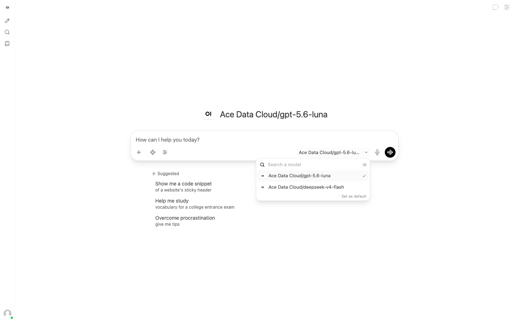
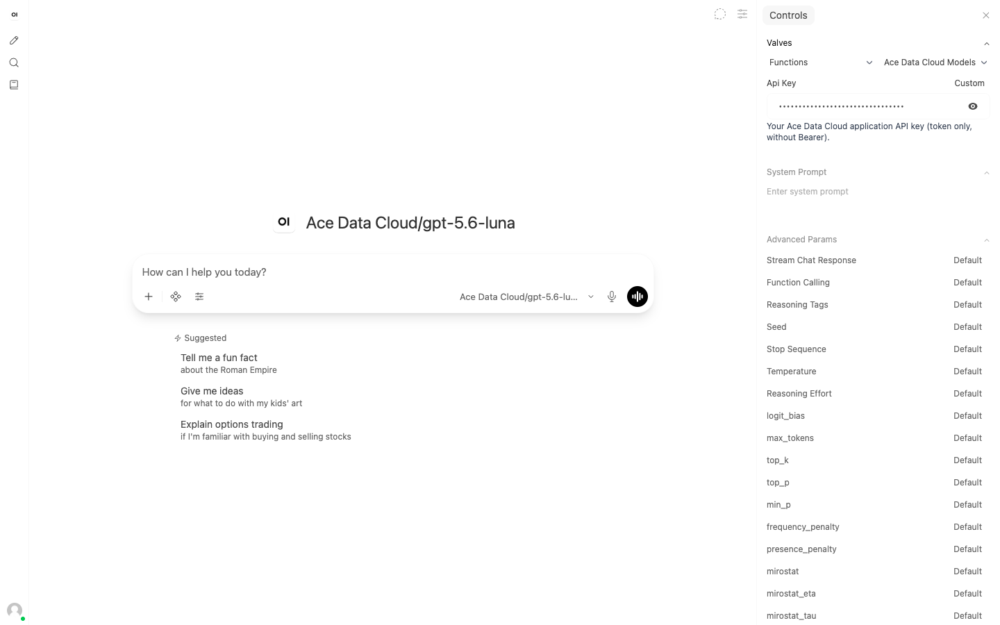
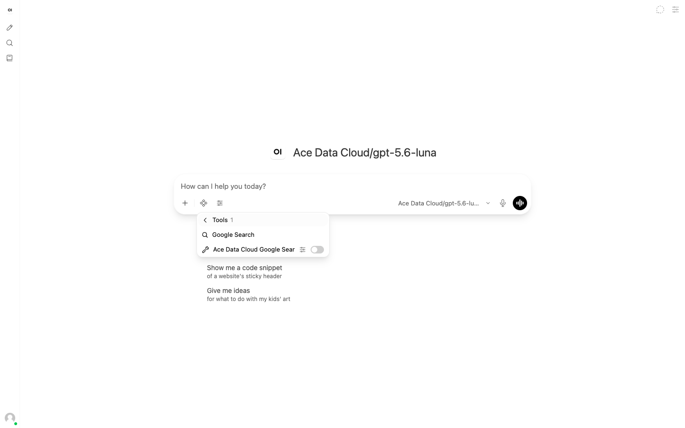
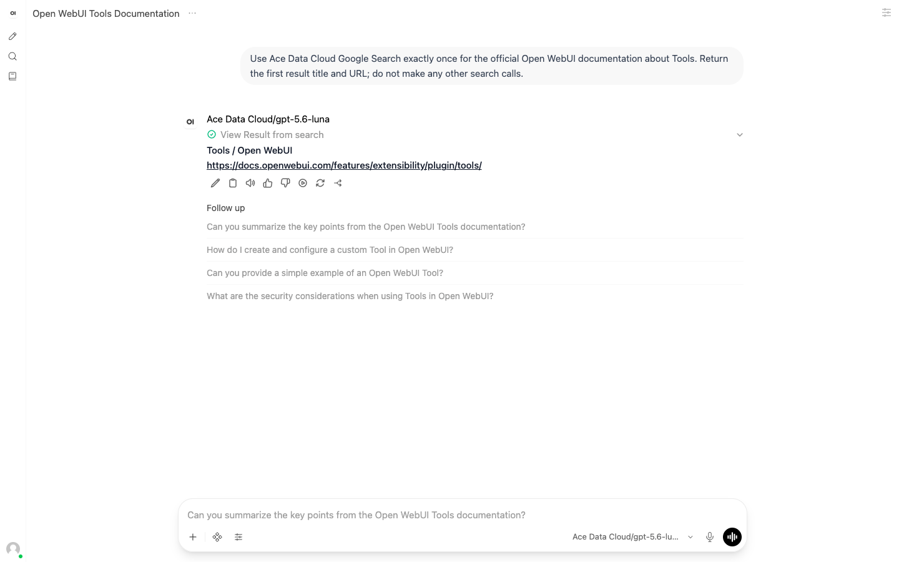
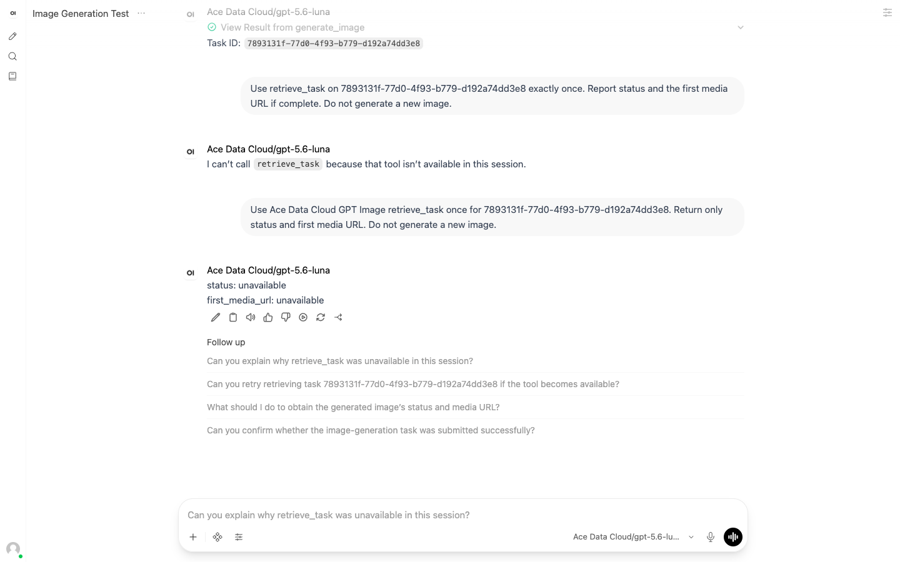
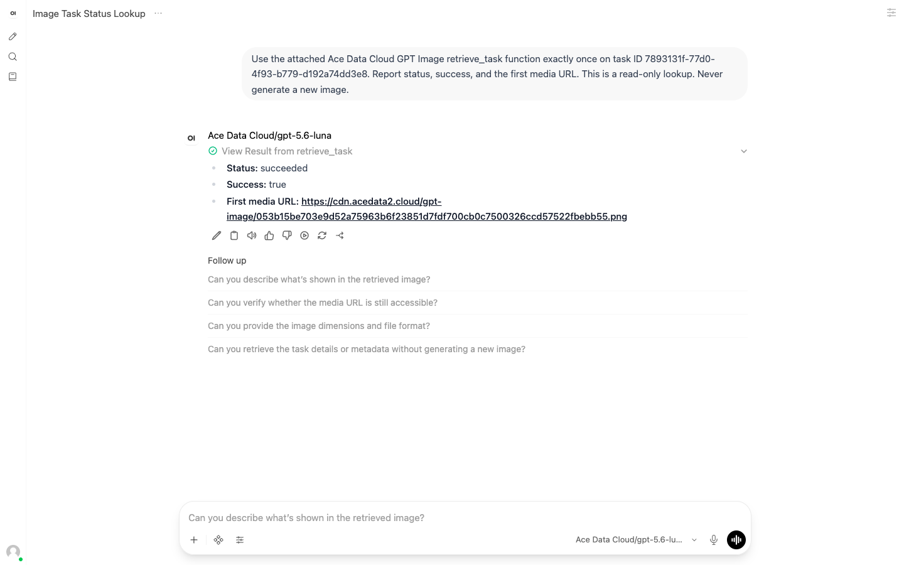

# Ace Data Cloud × Open WebUI：从安装到第一次调用

先通过 Open WebUI **原生 OpenAI 兼容 Connection** 接入 Ace Data Cloud 聊天模型，再按需安装服务 Tool。17 个服务 Tool 是互相独立的 Python 文件；如需每位聊天用户使用自己的模型 Key，可选装 Pipe Function。当前源码在 v0.12.0-slim 通过导入、普通用户权限、原生模型发现和既有任务查询；下文浏览器截图与收费首调示例仍来自之前的 v0.11.4 实测，密钥已遮蔽。具体证据边界见[验收记录](../docs/DEVELOPMENT.md)，完整方法与所需 API 见[服务清单](../docs/SERVICES.md)。

## 按服务名独立发现和安装

本次拟发布标题以用户搜索的服务名开头，采用 **Suno / Seedance / Happy Horse / GPT Image / Nano Banana by Ace Data Cloud**。这是 Ace 提供的集成，不冒充服务创建方官方。每项只需一个 Tool 文件，无须安装其他服务或另开 Pipelines。

**2026-10-18：Community 正式帖/Get 链接尚未核实，不把手动导入算官方上线。** 已准备每项独立教程与稿件；正式发布后须由现有账号人工查重，核对作者、源码及网站接受的标签和分类。

| 搜索服务 | 独立中文教程 | English | 单独源码 |
| --- | --- | --- | --- |
| Suno / 音乐 / 歌词 | [Suno](services/zh-Hans/suno.md) | [English](services/suno.md) | [Tool](../tools/suno.py) |
| Seedance / 视频 | [Seedance](services/zh-Hans/seedance.md) | [English](services/seedance.md) | [Tool](../tools/seedance.py) |
| HappyHorse / Happy Horse | [Happy Horse](services/zh-Hans/happy_horse.md) | [English](services/happy_horse.md) | [Tool](../tools/happy_horse.py) |
| GPT Image / 图片编辑 | [GPT Image](services/zh-Hans/gpt_image.md) | [English](services/gpt_image.md) | [Tool](../tools/gpt_image.py) |
| Nano Banana / 图片编辑 | [Nano Banana](services/zh-Hans/nano_banana.md) | [English](services/nano_banana.md) | [Tool](../tools/nano_banana.py) |

每份教程包含正式安装入口状态、注册/登录、Applications/通用应用、复制或创建 Key 真实脱敏图、个人 Key 粘贴位置、单次动作/同任务查询、结果、账单和排错。发布者材料见[独立条目清单](../docs/community/catalog.json)。下方历史截图保留旧 Ace-first 名称，不是新标题已上架的证据。

**发布状态（2026-10-19）：**[源码 PR #1](https://github.com/AceDataCloud/OpenWebUIPlugins/pull/1) 已合并。[GitHub v0.1.1 下载版本](https://github.com/AceDataCloud/OpenWebUIPlugins/releases/tag/v0.1.1) 提供每项独立 Python、导入 JSON、小 ZIP 及 SHA-256 清单，见[下载/导入说明](../docs/RELEASE.md)。Community 正式帖子仍待核实；源码合并或 GitHub 下载不等于官网搜索上架，正式 Get 前须核作者和精确源码。

## 1. 部署 Open WebUI

已有 v0.11.4 或更高版本可跳到第 2 步。以下本地启动命令不包含 Ace Data Cloud 密钥：

~~~bash
docker run -d --name open-webui -p 127.0.0.1:3000:8080 \
  -e WEBUI_SECRET_KEY="$(openssl rand -hex 32)" \
  -e ENABLE_VALVE_ENCRYPTION=true \
  -v open-webui:/app/backend/data \
  ghcr.io/open-webui/open-webui:v0.11.4
~~~

打开 http://localhost:3000，注册第一个管理员账号。这条命令用于单个本地容器；长期部署应把 <code>WEBUI_SECRET_KEY</code> 放在密钥管理系统中，重新创建容器时沿用，否则已加密的 Valve 值无法读取。服务器需要能以 HTTPS 访问 <code>api.acedata.cloud</code>。导入前逐个审查 Python 文件：Open WebUI 会在服务器进程内执行 Function 和 Tool。

## 2. 获取正确的应用 API Key

1. 登录 [Ace Data Cloud → Applications](https://platform.acedata.cloud/console/applications?utm_source=opensource&utm_medium=referral&utm_campaign=evergreen&utm_content=openwebui_readme_api_key)。
2. 打开 **General Application**，点击图中 **1** 复制已有 API Key；也可点 **2 Manage Keys** 新建一把专用于 Open WebUI 的 Key。单服务 Key 只能访问该服务。
3. 检查服务权限、当前价格与余额。如果启用 **Allowed APIs** 限制，须包含所选 Connection、Pipe 或 Tool 的全部接口，见[服务清单](../docs/SERVICES.md)。管理员的共享 Connection 与用户自己的 Tool Valve 可以使用不同的 Key。

只粘贴 token 字符串，不要加 <code>Bearer </code> 或引号。以 <code>platform-</code> 开头的平台管理 token 不是这里需要的应用 API Key。不要把 Key 放入聊天、提示词、导出配置或 GitHub Issue。

## 3. 用原生 Connection 接入聊天模型

[Open WebUI 官方文档](https://docs.openwebui.com/getting-started/quick-start/connect-a-provider/starting-with-functions/)建议对 OpenAI 兼容服务使用原生连接。Ace Data Cloud 已提供 <code>/v1/models</code> 与 <code>/v1/chat/completions</code>，普通模型接入不需要 Pipe。

**管理员**进入 **Admin Panel → Settings → Connections → OpenAI API**，新增连接并填写：

| 字段 | 值 |
| --- | --- |
| API Base URL | <code>https://api.acedata.cloud/v1</code> |
| API Key | 在管理员界面私密填写 Ace Data Cloud **应用** API Key |

保存并点击 **Verify Connection**。URL 必须以 <code>/v1</code> 结尾；Open WebUI 会追加 <code>/models</code> 和 <code>/chat/completions</code>。受限 Key 需允许 <code>/v1/models</code> 与 <code>/v1/chat/completions</code>。到 **Admin Panel → Settings → Models** 给目标用户或组授予所选模型的 **Read** 权限。选择账户实时模型列表中可用的模型；可用性和价格可能变化。发送 <code>Reply with the single word OK.</code>，确认回复为 <code>OK</code>。

管理员配置的 Connection Key 由获准使用这些模型的用户共享，须保存在服务器配置中，并限制模型访问。下文服务 Tool 使用各用户自己的 Key 和计费开关。若每位聊天用户必须使用独立 Ace Data Cloud Key，按第 4 步安装可选 Pipe。Open WebUI 的实验性用户直连 Connection 使用不同的浏览器存储方式，还需要 CORS 配置，不能视作同一部署路径。

## 4. 可选：安装个人 Key 模型 Pipe 并授权用户

1. 进入 **Admin Panel → Functions → Import From Link**，导入 [functions/acedatacloud_pipe.py](../functions/acedatacloud_pipe.py) 的 GitHub 文件链接。审查源码，保存为 <code>acedatacloud_models</code>，打开 **Active**。
2. 管理员 Valves 中的 <code>MODEL_IDS</code> 默认为 <code>gpt-5.6-luna,deepseek-v4-flash</code>。只保留你有权限使用的公开聊天模型 ID。
3. 进入 **Admin Panel → Settings → Models**，分别授予目标用户或组对每个 Pipe 模型的 **Read** 权限，或设为已登录用户可见。本地实测中，授权前普通用户的模型选择器为空；两个模型分别授权后才出现。无需开启 <code>BYPASS_MODEL_ACCESS_CONTROL</code>。

普通用户在模型选择器选择 **Ace Data Cloud/gpt-5.6-luna**。打开 **Chat Controls → Valves**，将第一个下拉框从 **Tools** 切换到 **Functions**，选择 **Ace Data Cloud Models**，在 **Api Key** 输入自己的 Key。输入框在界面上遮蔽；数据库静态加密仍需管理员开启第 1 步中的配置。

发送 <code>Reply with the single word OK.</code>。实测回复为 <code>OK</code>。Pipe 用用户自己的 Key 调用 <code>/v1/chat/completions</code>；受限 Key 需允许该路径。模型列表由管理员设置，Pipe 不调用 <code>/v1/models</code>。本节截图展示已实测的个人 Key 路径。

## 5. 独立安装 Google Search Tool 并完成首次搜索

管理员进入 **Workspace → Tools**，从 **Create** 菜单选择 **Import From Link**，导入 [tools/google_search.py](../tools/google_search.py)。审查源码后保存为 <code>acedatacloud_google_search</code>，给目标用户或组授予 Tool **Read** 权限。其余服务文件可按需逐个安装。普通用户只需读取与执行权限；创建或导入 Tool 的权限应留给可信管理员。

普通用户新开聊天，选择原生 Connection 中可用的 Ace Data Cloud 聊天模型；若使用可选 Pipe，则保留 **Ace Data Cloud/gpt-5.6-luna**。截图展示 Pipe 模型：

1. 点击输入框旁四菱形 **Integrations → Tools**，搜索 **Google Search by Ace Data Cloud**。
2. 点该 Tool 旁的滑块设置图标，在 **User Valves** 输入应用 Key，打开 **Allow Billable Calls**，点 **Save**。受限 Key 需允许 <code>/serp/google</code>。
3. 打开该 Tool 的开关，发送下面的可复制提示词。实测使用默认的 **Native** 工具调用模式。

~~~text
Use Google Search by Ace Data Cloud exactly once for the official Open WebUI documentation about Tools. Return the first result title and URL; do not make any other search calls.
~~~

实测返回标题 <code>Tools / Open WebUI</code> 与官方文档链接 https://docs.openwebui.com/features/extensibility/plugin/tools/。点 **View Result from search** 可查看 Tool 返回值。同一测试 Key 恰好匹配一条 HTTP 200 的账单记录，该账户折扣后扣费 **0.009 Credits**；你的价格以当前账单为准。用完后关闭 **Allow Billable Calls**。

## 6. 只生成一张图，再查询同一个任务

管理员另行安装 [tools/gpt_image.py](../tools/gpt_image.py)，并授予 Tool **Read** 权限。首次示例为 <code>gpt-image-2</code>、<code>1024x1024</code>、<code>low</code>、一张图。提交前检查当前价格与余额。受限 Key 同时允许 <code>/openai/images/generations</code> 和 <code>/openai/tasks</code>。

新开聊天，只启用 **GPT Image by Ace Data Cloud** Tool。通过滑块图标设置个人 Key，打开 **Allow Billable Calls**，发送：

~~~text
Call GPT Image by Ace Data Cloud generate_image exactly once with model gpt-image-2, size 1024x1024, quality low, and prompt: A single lime green origami boat on a plain cream background, clean studio photograph, no text. Report the task ID. Do not call generate_image again or poll automatically.
~~~

Tool 返回的 <code>task_id</code> 只表示任务已接受，**不表示图片已完成**。记下 ID 后立即关闭 **Allow Billable Calls**。本次实测只提交了一次，得到任务 <code>7893131f-77d0-4f93-b779-d192a74dd3e8</code>。

这张真实截图下半部分还记录了一次失败的后续尝试：该聊天已不再附带 Tool，模型无法调用 <code>retrieve_task</code>；上方任务 ID 仍然有效。按下文在新聊天重新启用 Tool，不要再次生成图片。

**新开聊天**，重新在 **Integrations → Tools** 启用 GPT Image，保持计费开关关闭。把下面占位符换成你自己的任务 ID：

~~~text
Use the attached GPT Image by Ace Data Cloud retrieve_task function exactly once on task ID <your-task-id>. Report status, success, and the first media URL. This is a read-only lookup. Never generate a new image.
~~~

若仍是 <code>pending</code>，稍后只重复 <code>retrieve_task</code> 查询同一个 ID。若模型说 Tool 不可用，先在当前聊天重新启用 Tool。看到 <code>status: succeeded</code> 和 <code>success: true</code> 后，再打开返回的图片 URL。聊天界面显示成功不等于媒体任务完成。

到 [Ace Data Cloud 控制台 Usage](https://platform.acedata.cloud/console) 核对这一次生成及 Credits 扣费。本次任务对应唯一一条 <code>ApiUsage</code> 记录，HTTP 200，在该账户折扣下扣费 **0.099 Credits**。这只是本次实测金额，不是固定报价；请按当前价格与套餐费率计算。查询任务不会再次提交生成。

## 其余 15 个服务与常见问题

[服务清单与 Dify 对照](../docs/SERVICES.md)列出全部 17 个 Tool 的方法、任务查询路径、受限 Key 所需接口，以及 Dify 更广的动作范围。媒体类 Tool 默认关闭 **Allow Billable Calls**，异步服务另提供只读 <code>retrieve_task</code>；Google Search 和 Face Transform 直接返回结果。Nano Banana 生成/编辑可显式选择 <code>nano-banana-2.1</code>；首次使用仍默认 <code>nano-banana-2-lite</code>，换模型前先查价格。Grok 视频默认已对齐 Dify 的公开模型 <code>grok-imagine-video-1.5-fast:reverse</code>、6 秒、480p。这批文件覆盖列出的首次使用动作，不宣称覆盖 Dify 全部高级动作或整个 API 目录。

| 现象 | 处理 |
| --- | --- |
| 普通用户看不到 Connection 模型、Pipe 模型或 Tool | 管理员分别授予模型和 Tool 的 Read 权限。导入权限是另一项；Connection 还须验证 Base URL 与 <code>/v1/models</code> 权限。 |
| 提示缺少 Key 或计费授权 | 到对应 Tool 的 User Valves 设置；共享 Connection Key 或可选 Pipe Key 与 Tool Key 独立。 |
| HTTP 401 / 403 | 核对应用 Key、过期时间、服务授权、余额和 Allowed APIs。 |
| HTTP 400 | 对照[服务清单](../docs/SERVICES.md)核对模型、动作与参数。 |
| HTTP 429 | 降低并发后等待，不要打开自动付费重试。 |
| 超时 / HTTP 5xx / 没有任务 ID | 先查请求历史，再决定是否重新提交付费任务。 |
| <code>pending</code> / 媒体 URL 为空 | 稍后只用同一任务 ID 调用 <code>retrieve_task</code>。 |

Tool 和 Function 在 Open WebUI 服务器进程内执行任意 Python。管理员应逐个审查源码、限制 Tool 导入权限，并用稳定的 <code>WEBUI_SECRET_KEY</code> 配合 <code>ENABLE_VALVE_ENCRYPTION=true</code>；输入框遮蔽不等于数据库加密。v0.11.4 的实验性 **Tool Permissions → Ask for approval** 默认关闭，且自动化与频道回复不受它拦截；本仓库的个人计费开关默认关闭。

[隐私说明](../PRIVACY.md) · [开发与验证](../docs/DEVELOPMENT.md) · [Community 投稿材料](../docs/COMMUNITY_SUBMISSION.md) · [反馈问题](https://github.com/AceDataCloud/OpenWebUIPlugins/issues) · dev@acedata.cloud
