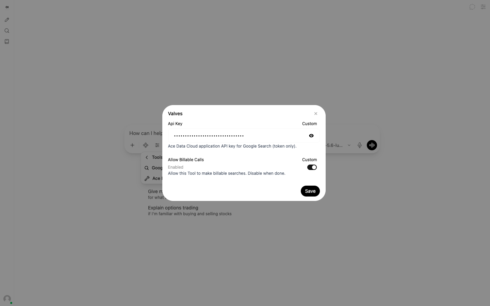

# Happy Horse for Open WebUI

Create Happy Horse (HappyHorse) text-to-video tasks through Ace Data Cloud and query final videos. This is an integration **by Ace Data Cloud**, not an official plugin from the Happy Horse creator. Install this service independently; no Ace bundle or separate Pipelines server is required.

[简体中文](zh-Hans/happy_horse.md) · [Current access and pricing](https://platform.acedata.cloud/models?utm_source=opensource&utm_medium=referral&utm_campaign=evergreen&utm_content=happy_horseopenwebui_readme_pricing)

## 1. Find and install the correct Tool

**Community publication is pending (2026-10-18). There is no verified Get/install post URL yet.** In the [official Community library](https://openwebui.com/search), manually search **Happy Horse**, then check for **Happy Horse by Ace Data Cloud**, the Ace Data Cloud author, and the reviewed source. A matching name alone does not establish ownership. The official account holder must check for an existing entry before publishing; this guide does not claim that search currently finds ours.

After a verified post is linked here, use its **Get → your Open WebUI URL → Import** flow, review the code, and save. Functions go to Admin Panel; this service is a **Tool** and belongs in **Workspace → Tools**. Until Community publication, use the [first-party v0.1.1 GitHub release](https://github.com/AceDataCloud/OpenWebUIPlugins/releases/tag/v0.1.1) for this service’s separate Python, import JSON or ZIP; see the [download/import instructions](../../docs/RELEASE.md). An administrator can also import the [tagged source file](https://github.com/AceDataCloud/OpenWebUIPlugins/blob/v0.1.1/tools/happy_horse.py) using **Workspace → Tools → Create → Import From Link**. GitHub distribution is available independently of Community publication and is not evidence of Community search/Get. Save an existing file over its prior entry instead of creating a duplicate. Proposed Tool version: **0.1.1**.

The administrator grants intended users **Read** access. Keep code creation/import permissions with trusted administrators. Source review is required because a Tool runs Python inside your server. Open WebUI installs this one file without another Ace Tool; its own `httpx` requirement must be available.


Historical real v0.11.4 screenshot, first committed 2026-10-09. It shows manual installation of the previous names; the service-first title above is the proposed update. It does not prove Community publication.

## 2. Register, sign in, and copy or create a Key

1. Register or sign in at [Ace Data Cloud → Applications](https://platform.acedata.cloud/console/applications?utm_source=opensource&utm_medium=referral&utm_campaign=evergreen&utm_content=happy_horseopenwebui_readme_api_key). If needed, choose **Initialize General Application** first.
2. Open **General Application**. Check **Happy Horse** access, current price and balance. A service-specific key works only for that service; a General Application key covers only services your account is entitled to use.
3. Copy the selected application key (**1**) or open **Manage Keys** (**2**) and choose **Create** for a dedicated Open WebUI key.


4. Use a name such as `Open WebUI Happy Horse`. Set expiry, usage limits and Allowed APIs as appropriate, create, then copy from the application/credential list. Restricted keys need: `/happyhorse/tasks`, `/happyhorse/videos`.


These are redacted Ace Console reference screenshots reused byte-for-byte from [SunoDify](https://github.com/AceDataCloud/SunoDify/tree/8d3d03570e73324220f111f7fe343da0792a8071/_assets/tutorial), downloaded and reviewed 2026-10-18. The old example name says `Dify tutorial`; enter `Open WebUI Happy Horse` instead. No real credential is visible. Copy only the token, without `Bearer ` or quotes. A `platform-...` management token is not the service key.

## 3. Paste the personal Key in Open WebUI

As an ordinary user, select an authorized chat model that supports tool calling. Open the composer's **Integrations → Tools**, find **Happy Horse by Ace Data Cloud**, and open its sliders/settings. In **User Valves**, paste your Key into **Api Key** and Save. The shared model Connection and optional model Pipe do not fill this Tool's Key. The model itself can incur separate charges.



This historical v0.11.4 real screenshot uses Google Search to show the same Key and **Allow Billable Calls** fields. It is not a new Happy Horse run. The switch defaults **off** in the source; the picture shows a tester who explicitly turned it on. Enable Valve encryption with a stable server secret to protect stored keys.

## 4. First action, then the same task

Check current pricing and balance before any generation. Enable only this Tool and turn on **Allow Billable Calls** only for the intended action. Do not send this prompt unless the charge is intended:

```text
Use Happy Horse by Ace Data Cloud generate_video exactly once with prompt A quiet mountain lake at sunrise; duration 3; resolution 720P; ratio 16:9. Report the task ID. Do not retry, generate again, or poll automatically.
```

Record `task_id`, turn **Allow Billable Calls** off, and keep this Tool attached. Query the same ID later:

```text
Use Happy Horse by Ace Data Cloud retrieve_task exactly once with task_id <your-task-id>. Report status, success, and media_urls. This is read-only. Never generate a new task.
```

`pending` means wait and query that same ID again later; never regenerate to poll. A result is complete only with terminal success and an openable image/audio/video link. These prompts specify the intended contract; they are not evidence of a new Happy Horse generation. Advanced actions outside the listed methods are not included.

## 5. Results, usage and common issues

An accepted task returns a task ID. A finished query returns `status: succeeded`, `success: true`, and final `media_urls`; failed/pending tasks have no final media URLs. Open your own output and match the unique generation usage in [Ace usage history](https://platform.acedata.cloud/console/usages). Amounts are Credits and depend on current account pricing; the model, titles, tags and follow-up suggestions can create additional requests. No fixed historical test price is promised here.

| Problem | Check |
| --- | --- |
| Tool missing | Administrator imported this one file and granted **Read**; re-enable it for the current chat. |
| Key/billable switch error | Fill this Tool's personal User Valves; enable the switch only for the intended paid submit. Queries work with it off. |
| 401/403 | Application Key, expiry, service access, balance and Allowed APIs. |
| Pending task | Query the same task ID later; do not submit again. |
| Timeout/5xx | Check existing request history for an accepted task before any resubmission. Paid actions are never automatically retried. |

[Scope and APIs](../../docs/SERVICES.md) · [Privacy](../../PRIVACY.md) · [Issues](https://github.com/AceDataCloud/OpenWebUIPlugins/issues) · dev@acedata.cloud
